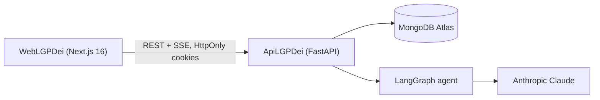
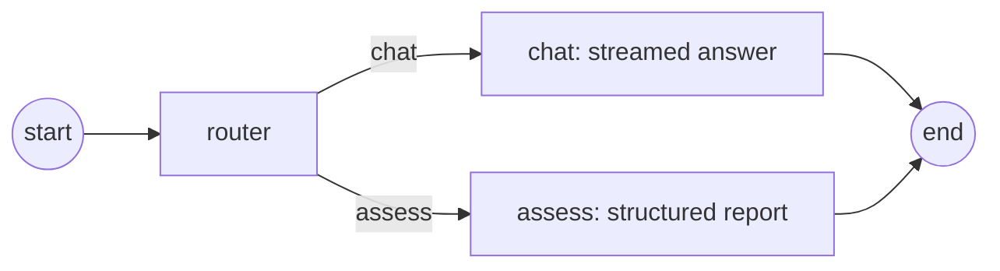

# LGPDei

**English** | [Português (Brasil)](README.pt-BR.md)

AI assistant that teaches Brazil's data protection law (**LGPD**, Lei 13.709/2018) and finds compliance gaps in any
line of work: tech, HR, healthcare, marketing, public sector. Users describe how they handle data or upload
documents, chat about it, and ask for a structured compliance report with a score, risk level, findings and legal
citations.

> Assistente educativo de conformidade com a LGPD. Não substitui assessoria jurídica.

## Live demo

- Web app: [lgpdei-web-five.vercel.app](https://lgpdei-web-five.vercel.app/) (Vercel)
- API: [lgpdei-api.onrender.com](https://lgpdei-api.onrender.com) (Render), interactive docs at
  [`/docs`](https://lgpdei-api.onrender.com/docs)
- Database: MongoDB Atlas

## Why I built it

My day-to-day stack is TypeScript, Vue/Nuxt and Node.js. LGPDei is deliberately built with Python/FastAPI and
Next.js/React, stacks I knew only at a basic level, to show that a developer with solid fundamentals can deliver a
production-ready product in a different ecosystem. HTTP, authentication, data modelling, testing and security carry
over between languages; AI-assisted development speeds up learning the idioms and libraries of a new stack, while the
architecture, review and quality decisions remain the engineer's.

| Streaming chat grounded in the LGPD | Structured compliance report |
| --- | --- |
|  |  |

## Architecture



The agent is a single LangGraph graph. A router picks the intent, then either the chat node answers (tokens are
streamed to the browser as they are generated) or the assess node returns a Pydantic-validated `AssessmentOutput`.



| Folder | Stack |
| --- | --- |
| `ApiLGPDei` | Python 3.12, FastAPI, Beanie (MongoDB), LangGraph, LangChain Anthropic, slowapi, pypdf, python-docx |
| `WebLGPDei` | Next.js 16, React 19, Tailwind CSS 4, react-markdown |

## Features

- Anonymous sessions identified by an HttpOnly cookie that is reused for every guest session of the browser; guest
  data expires after 72 hours (MongoDB TTL index).
- Optional account (JWT in an HttpOnly cookie); guest sessions are adopted by the account on sign-up or login and
  account sessions are kept until the user deletes them.
- Privacy controls: consent capture, profile correction, data export, account deletion, privacy notice and terms (see
  [LGPD compliance](#lgpd-compliance)).
- Chat with Server-Sent Events streaming, in Portuguese or English.
- Guardrails: the agent only answers questions about the LGPD, never writes code, gives no direct legal advice or
  drafted documents, and treats messages and documents as content rather than instructions. Every chat answer and
  report ends with the "educational tool, not legal advice" disclaimer, appended by the API.
- Document upload (PDF, DOCX, TXT, MD, CSV) with per-file and per-session limits; extracted text grounds the answers.
- Compliance report: overall risk, 0-100 score, findings with severity, legal reference, evidence and recommendation.
- Per-IP rate limits for sessions, messages and uploads, configurable through environment variables.

## Getting started

Requirements: Python 3.12, Node.js 24, Docker, an Anthropic API key.

```bash
cp .env.example .env                      # MongoDB root credentials for docker compose
docker compose -f docker-compose.yml -f docker-compose.dev.yml up -d mongo   # MongoDB on 127.0.0.1:27017

cd ApiLGPDei
cp .env.example .env                      # set ANTHROPIC_API_KEY, SESSION_SECRET, JWT_SECRET and the Mongo credentials
python -m pip install -e ".[dev]"
python -m app                             # http://localhost:3334

cd ../WebLGPDei
cp .env.example .env.local
npm install
npm run dev                               # http://localhost:3000
```

Or run everything in containers: `docker compose --profile app up --build`. MongoDB runs with authentication
(`MONGO_ROOT_USERNAME` / `MONGO_ROOT_PASSWORD` from the root `.env`) and is only published, on `127.0.0.1`, when
`docker-compose.dev.yml` is included. The credentials only apply when the data volume is first created; an existing
volume created without them must be recreated (`docker compose down -v`, which deletes its data).

### API environment variables

| Variable | Default | Description |
| --- | --- | --- |
| `MONGODB_URI` | `mongodb://127.0.0.1:27017/lgpdei` | Connection string including the database name and credentials |
| `SESSION_SECRET` | required | HMAC key for anonymous session tokens |
| `JWT_SECRET` | required | Signing key for account tokens |
| `JWT_EXPIRES_DAYS` | `7` | Account cookie lifetime |
| `SESSION_TTL_HOURS` | `72` | Anonymous session lifetime |
| `ANTHROPIC_API_KEY` | required | Claude API key |
| `ANTHROPIC_MODEL` | `claude-haiku-5-5` | Model used by both graph nodes |
| `CORS_ORIGINS` | `http://localhost:3000` | Comma-separated web origins |
| `COOKIE_SAMESITE` / `COOKIE_SECURE` | `lax` / `true` | Set `COOKIE_SECURE=false` only for local http; use `none` / `true` when web and API are on different sites |
| `FORWARDED_ALLOW_IPS` | `127.0.0.1` | Docker image: proxy IPs trusted for `X-Forwarded-For` (client IP for rate limits) |
| `RATE_LIMIT_AUTH_PER_MINUTE` | `10` | Per IP, for each of login, register and the `/auth/me` profile, export and deletion routes |
| `RATE_LIMIT_SESSIONS_PER_HOUR` | `5` | Per IP |
| `RATE_LIMIT_MESSAGES_PER_HOUR` | `30` | Per IP |
| `RATE_LIMIT_UPLOADS_PER_HOUR` | `10` | Per IP |
| `MAX_FILES_PER_SESSION` / `MAX_FILE_SIZE_MB` / `MAX_EXTRACTED_TEXT_CHARS` | `10` / `5` / `50000` | Upload limits |

The web app reads two variables at build time: `NEXT_PUBLIC_API_BASE` (default `http://localhost:3334/api`), the base
URL the browser calls, and `API_ORIGIN` (default `http://localhost:3334`), the target of the `/api/*` rewrite in
`next.config.ts`. Setting `NEXT_PUBLIC_API_BASE=/api` sends every request through the web app's own origin.

### API endpoints

All routes are under `/api`; interactive docs at `/docs`.

| Method | Path | Description |
| --- | --- | --- |
| `GET` | `/health` | Health check |
| `POST` | `/auth/register`, `/auth/login`, `/auth/logout` | Account cookie; register requires `consent: true`; logout revokes all tokens |
| `GET` | `/auth/me` | Current user |
| `PATCH` | `/auth/me` | Update `name` / `email` (409 if the e-mail is taken; an e-mail change revokes other tokens) |
| `DELETE` | `/auth/me` | Delete the account and all its data; body `{ "password" }` |
| `GET` | `/auth/me/export` | JSON download with profile, consent, sessions, messages, reports and document text |
| `GET` `POST` | `/sessions` | List / create sessions; a guest's first session requires `consent: true` |
| `GET` `PATCH` `DELETE` | `/sessions/{id}` | Session detail, rename, delete |
| `POST` | `/sessions/{id}/messages/stream` | Send a message, SSE response |
| `POST` `DELETE` | `/sessions/{id}/documents[/{docId}]` | Upload / remove a document |
| `GET` | `/documents` | All documents across the caller's sessions |

## Quality

- `ApiLGPDei`: `pytest` runs 47 tests against a real MongoDB with the LLM replaced by a fake chat model: auth, token
  revocation, consent, retention, account export and deletion, session ownership, uploads, rate limiting, token
  streaming through the graph and the structured assessment.
- `WebLGPDei`: `npm run lint` (ESLint flat config with the React Compiler rules), `npm run typecheck` and
  `npm run build`.
- GitHub Actions runs both suites and builds both Docker images on every push and pull request.

## Deployment

Production (see [Live demo](#live-demo)):

| Part | Host | Notes |
| --- | --- | --- |
| `WebLGPDei` | Vercel | Built by Vercel's Next.js runtime with `NEXT_PUBLIC_API_BASE=/api` and `API_ORIGIN=https://lgpdei-api.onrender.com`. |
| `ApiLGPDei` | Render | The Dockerfile binds uvicorn to the `PORT` Render provides (default `3334`). |
| MongoDB | MongoDB Atlas | `MONGODB_URI` is the Atlas connection string including the `lgpdei` database name. |

The browser only talks to the Vercel origin: the `/api/*` rewrite forwards requests to Render, so the auth and session
cookies are first-party and the API defaults (`COOKIE_SAMESITE=lax`, `COOKIE_SECURE=true`) work as is. `CORS_ORIGINS`
only matters if a browser calls the API directly. Set `FORWARDED_ALLOW_IPS` to the proxy addresses in front of the API
so rate limits see the real client IP.

Both Dockerfiles (`ApiLGPDei/Dockerfile`, and `WebLGPDei/Dockerfile` using Next.js standalone output) are also built by
CI and used by `docker compose --profile app` for self-hosting.

## LGPD compliance

| Topic | Implementation |
| --- | --- |
| Transparency | `/privacidade` (privacy notice) and `/termos` (terms), linked from the footer, the auth page and every consent checkbox. The privacy notice lists the processors: Anthropic (USA), Render (API hosting, USA), MongoDB Atlas (database, São Paulo) and Vercel (web hosting, USA). |
| Consent (art. 7, I and art. 33, VIII) | Unchecked checkbox covering terms, privacy notice, transfer to Anthropic (USA) and an 18+ statement. Required on register (`User.consent_version` / `consent_at`) and before a guest's first session (stored on the session; later guest sessions of the same browser inherit it). Uploads and messages to a guest session without current consent are rejected. Bump `CONSENT_VERSION` in `app/consent.py` whenever the texts change. |
| Sensitive data (art. 11) | The consent gate and the chat input warn users not to send sensitive or third-party personal data. |
| Retention | Guest sessions, messages and documents expire 72 h after creation (TTL index). Account sessions have `expires_at = null` and are kept until deleted. Only extracted document text is stored, never the file. |
| Data subject rights (art. 18) | Access and portability: "Baixar meus dados". Correction: "Editar perfil". Deletion: session / file delete (with confirmation) and "Excluir conta" (password required; revoking consent = deleting the account). |
| Security | bcrypt, HttpOnly cookies (`Secure` by default), JWT `token_version` revoked on logout, e-mail change and deletion, rate limits on auth routes, generic streaming errors (details only in server logs), MongoDB with authentication and no public port. |
| Logs | `app/log_config.json` formats the uvicorn access log without client IPs; IPs are only held in memory by the rate limiter. |

## Legal notice

This tool is educational and **does not replace legal advice**. Conversations are sent to the Anthropic API.
