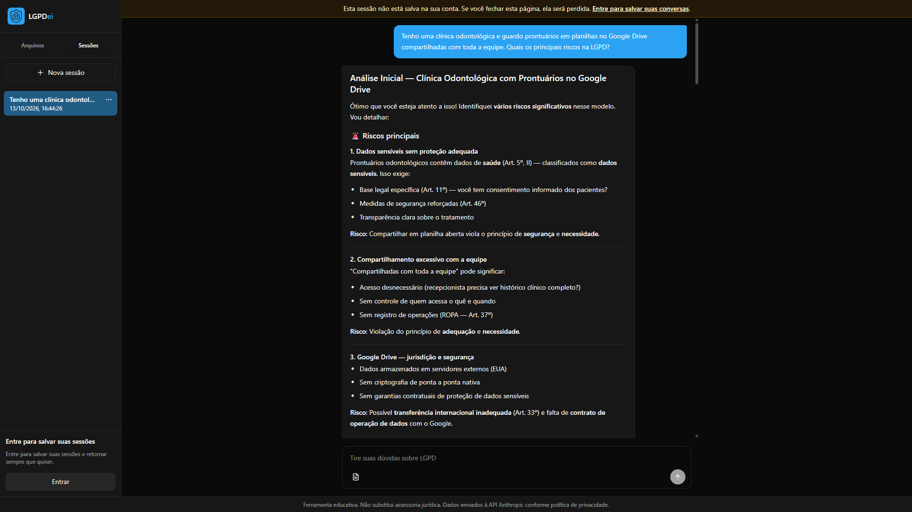
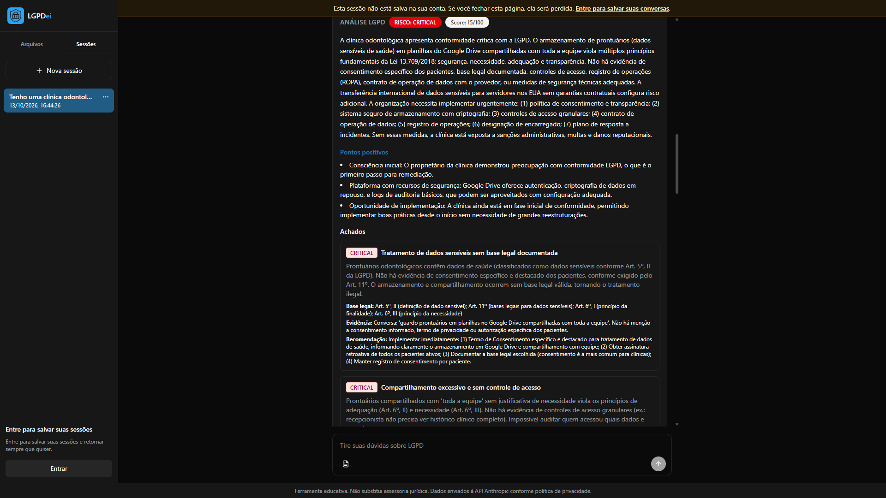
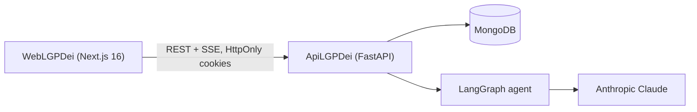
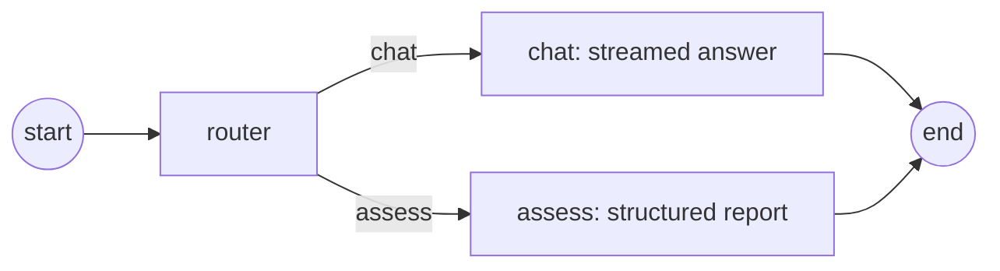

# LGPDei

AI assistant that teaches Brazil's data protection law (**LGPD**, Lei 13.709/2018) and finds compliance gaps in any
line of work: tech, HR, healthcare, marketing, public sector. Users describe how they handle data or upload
documents, chat about it, and ask for a structured compliance report with a score, risk level, findings and legal
citations.

> Assistente educativo de conformidade com a LGPD. Não substitui assessoria jurídica.

| Streaming chat grounded in the LGPD | Structured compliance report |
| --- | --- |
|  |  |

## Architecture



The agent is a single LangGraph graph. A router picks the intent, then either the chat node answers (tokens are
streamed to the browser as they are generated) or the assess node returns a Pydantic-validated `AssessmentOutput`.



| Folder | Stack |
| --- | --- |
| `ApiLGPDei` | Python 3.12, FastAPI, Beanie (MongoDB), LangGraph, LangChain Anthropic, slowapi, pypdf, python-docx |
| `WebLGPDei` | Next.js 16, React 19, Tailwind CSS 4, react-markdown |

## Features

- Anonymous sessions identified by an HttpOnly cookie; session data expires after 72 hours (MongoDB TTL index).
- Optional account (JWT in an HttpOnly cookie); guest sessions are linked to the account on sign-up or login.
- Chat with Server-Sent Events streaming, in Portuguese or English.
- Document upload (PDF, DOCX, TXT, MD, CSV) with per-file and per-session limits; extracted text grounds the answers.
- Compliance report: overall risk, 0-100 score, findings with severity, legal reference, evidence and recommendation.
- Per-IP rate limits for sessions, messages and uploads, configurable through environment variables.

## Getting started

Requirements: Python 3.12, Node.js 24, Docker, an Anthropic API key.

```bash
docker compose up -d                      # MongoDB on localhost:27017

cd ApiLGPDei
cp .env.example .env                      # set ANTHROPIC_API_KEY, SESSION_SECRET, JWT_SECRET
python -m pip install -e ".[dev]"
python -m app                             # http://localhost:3334

cd ../WebLGPDei
cp .env.example .env.local
npm install
npm run dev                               # http://localhost:3000
```

Or run everything in containers: `docker compose --profile app up --build`.

### API environment variables

| Variable | Default | Description |
| --- | --- | --- |
| `MONGODB_URI` | `mongodb://127.0.0.1:27017/lgpdei` | Connection string including the database name |
| `SESSION_SECRET` | required | HMAC key for anonymous session tokens |
| `JWT_SECRET` | required | Signing key for account tokens |
| `JWT_EXPIRES_DAYS` | `7` | Account cookie lifetime |
| `SESSION_TTL_HOURS` | `72` | Anonymous session lifetime |
| `ANTHROPIC_API_KEY` | required | Claude API key |
| `ANTHROPIC_MODEL` | `claude-haiku-4-5` | Model used by both graph nodes |
| `CORS_ORIGINS` | `http://localhost:3000` | Comma-separated web origins |
| `COOKIE_SAMESITE` / `COOKIE_SECURE` | `lax` / `false` | Use `none` / `true` when web and API are on different sites |
| `RATE_LIMIT_SESSIONS_PER_HOUR` | `5` | Per IP |
| `RATE_LIMIT_MESSAGES_PER_HOUR` | `30` | Per IP |
| `RATE_LIMIT_UPLOADS_PER_HOUR` | `10` | Per IP |
| `MAX_FILES_PER_SESSION` / `MAX_FILE_SIZE_MB` / `MAX_EXTRACTED_TEXT_CHARS` | `10` / `5` / `50000` | Upload limits |

The web app only needs `NEXT_PUBLIC_API_BASE` (default `http://localhost:3334/api`), which is inlined at build time.

### API endpoints

All routes are under `/api`; interactive docs at `/docs`.

| Method | Path | Description |
| --- | --- | --- |
| `GET` | `/health` | Health check |
| `POST` | `/auth/register`, `/auth/login`, `/auth/logout` | Account cookie |
| `GET` | `/auth/me` | Current user |
| `GET` `POST` | `/sessions` | List / create sessions |
| `GET` `PATCH` `DELETE` | `/sessions/{id}` | Session detail, rename, delete |
| `POST` | `/sessions/{id}/messages/stream` | Send a message, SSE response |
| `POST` `DELETE` | `/sessions/{id}/documents[/{docId}]` | Upload / remove a document |
| `GET` | `/documents` | All documents across the caller's sessions |

## Quality

- `ApiLGPDei`: `pytest` runs 25 tests against a real MongoDB with the LLM replaced by a fake chat model: auth, session
  ownership, uploads, rate limiting, token streaming through the graph and the structured assessment.
- `WebLGPDei`: `npm run lint` (ESLint flat config with the React Compiler rules) and `npm run typecheck`.
- GitHub Actions runs both suites and builds both Docker images on every push and pull request.

## Deployment

Both apps ship with a Dockerfile (`ApiLGPDei/Dockerfile`, `WebLGPDei/Dockerfile` using Next.js standalone output).
A low-cost setup is MongoDB Atlas (free tier), the API on Render, Fly.io or Railway, and the web app on Vercel. When
the web and API live on different sites, set `COOKIE_SAMESITE=none`, `COOKIE_SECURE=true` and add the web origin to
`CORS_ORIGINS`.

## Legal notice

This tool is educational and **does not replace legal advice**. Conversations are sent to the Anthropic API.
