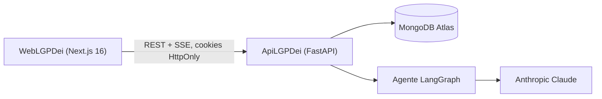
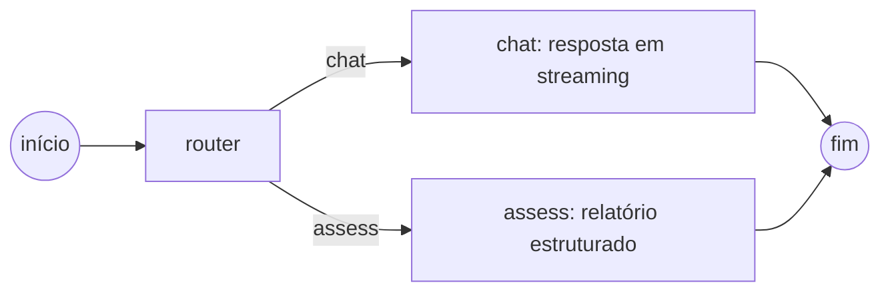

# LGPDei

[English](README.md) | **Português (Brasil)**

Assistente de IA que ensina a Lei Geral de Proteção de Dados (**LGPD**, Lei 13.709/2018) e encontra lacunas de
conformidade em qualquer área de atuação: tecnologia, RH, saúde, marketing, setor público. O usuário descreve como
trata dados ou envia documentos, conversa sobre eles e pede um relatório de conformidade estruturado com nota, nível de
risco, achados e referências legais.

> Assistente educativo de conformidade com a LGPD. Não substitui assessoria jurídica.

## Demonstração

- Aplicação web: [lgpdei-web-five.vercel.app](https://lgpdei-web-five.vercel.app/) (Vercel)
- API: [lgpdei-api.onrender.com](https://lgpdei-api.onrender.com) (Render), documentação interativa em
  [`/docs`](https://lgpdei-api.onrender.com/docs)
- Banco de dados: MongoDB Atlas

## Por que construí este projeto

Minha stack do dia a dia é TypeScript, Vue/Nuxt e Node.js. O LGPDei foi construído de propósito com Python/FastAPI e
Next.js/React, stacks que eu conhecia apenas em nível básico, para mostrar que um desenvolvedor com fundamentos sólidos
consegue entregar um produto pronto para produção em outro ecossistema. HTTP, autenticação, modelagem de dados, testes e
segurança se transferem entre linguagens; o desenvolvimento assistido por IA acelera o aprendizado dos idiomas e
bibliotecas de uma nova stack, enquanto as decisões de arquitetura, revisão e qualidade continuam sendo do engenheiro.

| Chat em streaming fundamentado na LGPD | Relatório de conformidade estruturado |
| --- | --- |
|  |  |

## Arquitetura



O agente é um único grafo LangGraph. Um roteador identifica a intenção e, em seguida, o nó de chat responde (os tokens
são transmitidos ao navegador conforme são gerados) ou o nó de avaliação retorna um `AssessmentOutput` validado pelo
Pydantic.



| Pasta | Stack |
| --- | --- |
| `ApiLGPDei` | Python 3.12, FastAPI, Beanie (MongoDB), LangGraph, LangChain Anthropic, slowapi, pypdf, python-docx |
| `WebLGPDei` | Next.js 16, React 19, Tailwind CSS 4, react-markdown |

## Funcionalidades

- Sessões anônimas identificadas por um cookie HttpOnly reutilizado em todas as sessões de visitante do navegador; os
  dados de visitantes expiram após 72 horas (índice TTL do MongoDB).
- Conta opcional (JWT em cookie HttpOnly); as sessões de visitante são vinculadas à conta no cadastro ou login, e as
  sessões de conta são mantidas até o usuário excluí-las.
- Controles de privacidade: registro de consentimento, correção de perfil, exportação de dados, exclusão de conta,
  política de privacidade e termos (veja [Conformidade com a LGPD](#conformidade-com-a-lgpd)).
- Chat com streaming via Server-Sent Events, em português ou inglês.
- Guardrails: o agente só responde perguntas sobre a LGPD, nunca escreve código, não dá aconselhamento jurídico direto
  nem redige documentos, e trata mensagens e documentos como conteúdo, não como instruções. Toda resposta do chat e todo
  relatório terminam com o aviso "ferramenta educativa, não substitui assessoria jurídica", adicionado pela API.
- Envio de documentos (PDF, DOCX, TXT, MD, CSV) com limites por arquivo e por sessão; o texto extraído fundamenta as
  respostas.
- Relatório de conformidade: risco geral, nota de 0 a 100, achados com gravidade, referência legal, evidência e
  recomendação.
- Limites de requisição por IP para sessões, mensagens e uploads, configuráveis por variáveis de ambiente.

## Como executar

Requisitos: Python 3.12, Node.js 24, Docker e uma chave da API da Anthropic.

```bash
cp .env.example .env                      # credenciais root do MongoDB para o docker compose
docker compose -f docker-compose.yml -f docker-compose.dev.yml up -d mongo   # MongoDB em 127.0.0.1:27017

cd ApiLGPDei
cp .env.example .env                      # defina ANTHROPIC_API_KEY, SESSION_SECRET, JWT_SECRET e as credenciais do Mongo
python -m pip install -e ".[dev]"
python -m app                             # http://localhost:3334

cd ../WebLGPDei
cp .env.example .env.local
npm install
npm run dev                               # http://localhost:3000
```

Ou execute tudo em contêineres: `docker compose --profile app up --build`. O MongoDB roda com autenticação
(`MONGO_ROOT_USERNAME` / `MONGO_ROOT_PASSWORD` do `.env` da raiz) e só é publicado, em `127.0.0.1`, quando o
`docker-compose.dev.yml` é incluído. As credenciais só se aplicam quando o volume de dados é criado; um volume existente
criado sem elas precisa ser recriado (`docker compose down -v`, o que apaga os dados).

### Variáveis de ambiente da API

| Variável | Padrão | Descrição |
| --- | --- | --- |
| `MONGODB_URI` | `mongodb://127.0.0.1:27017/lgpdei` | String de conexão com o nome do banco e as credenciais |
| `SESSION_SECRET` | obrigatória | Chave HMAC dos tokens de sessão anônima |
| `JWT_SECRET` | obrigatória | Chave de assinatura dos tokens de conta |
| `JWT_EXPIRES_DAYS` | `7` | Validade do cookie da conta |
| `SESSION_TTL_HOURS` | `72` | Validade da sessão anônima |
| `ANTHROPIC_API_KEY` | obrigatória | Chave da API do Claude |
| `ANTHROPIC_MODEL` | `claude-haiku-5-5` | Modelo usado pelos dois nós do grafo |
| `CORS_ORIGINS` | `http://localhost:3000` | Origens web separadas por vírgula |
| `COOKIE_SAMESITE` / `COOKIE_SECURE` | `lax` / `true` | Use `COOKIE_SECURE=false` apenas em http local; use `none` / `true` quando web e API estiverem em sites diferentes |
| `FORWARDED_ALLOW_IPS` | `127.0.0.1` | Imagem Docker: IPs de proxy confiáveis para `X-Forwarded-For` (IP do cliente nos limites de requisição) |
| `RATE_LIMIT_AUTH_PER_MINUTE` | `10` | Por IP, para login, cadastro e as rotas de perfil, exportação e exclusão em `/auth/me` |
| `RATE_LIMIT_SESSIONS_PER_HOUR` | `5` | Por IP |
| `RATE_LIMIT_MESSAGES_PER_HOUR` | `30` | Por IP |
| `RATE_LIMIT_UPLOADS_PER_HOUR` | `10` | Por IP |
| `MAX_FILES_PER_SESSION` / `MAX_FILE_SIZE_MB` / `MAX_EXTRACTED_TEXT_CHARS` | `10` / `5` / `50000` | Limites de upload |

A aplicação web lê duas variáveis no build: `NEXT_PUBLIC_API_BASE` (padrão `http://localhost:3334/api`), a URL base
chamada pelo navegador, e `API_ORIGIN` (padrão `http://localhost:3334`), o destino do rewrite `/api/*` em
`next.config.ts`. Com `NEXT_PUBLIC_API_BASE=/api`, todas as requisições passam pela própria origem da aplicação web.

### Endpoints da API

Todas as rotas ficam em `/api`; documentação interativa em `/docs`.

| Método | Caminho | Descrição |
| --- | --- | --- |
| `GET` | `/health` | Verificação de saúde |
| `POST` | `/auth/register`, `/auth/login`, `/auth/logout` | Cookie da conta; o cadastro exige `consent: true`; o logout revoga todos os tokens |
| `GET` | `/auth/me` | Usuário atual |
| `PATCH` | `/auth/me` | Atualiza `name` / `email` (409 se o e-mail já estiver em uso; a troca de e-mail revoga os outros tokens) |
| `DELETE` | `/auth/me` | Exclui a conta e todos os seus dados; corpo `{ "password" }` |
| `GET` | `/auth/me/export` | Download em JSON com perfil, consentimento, sessões, mensagens, relatórios e texto dos documentos |
| `GET` `POST` | `/sessions` | Lista / cria sessões; a primeira sessão de um visitante exige `consent: true` |
| `GET` `PATCH` `DELETE` | `/sessions/{id}` | Detalhe, renomeação e exclusão da sessão |
| `POST` | `/sessions/{id}/messages/stream` | Envia uma mensagem, resposta em SSE |
| `POST` `DELETE` | `/sessions/{id}/documents[/{docId}]` | Envia / remove um documento |
| `GET` | `/documents` | Todos os documentos das sessões do usuário |

## Qualidade

- `ApiLGPDei`: o `pytest` executa 47 testes contra um MongoDB real, com o LLM substituído por um modelo de chat falso:
  autenticação, revogação de tokens, consentimento, retenção, exportação e exclusão de conta, posse de sessões, uploads,
  limites de requisição, streaming de tokens pelo grafo e a avaliação estruturada.
- `WebLGPDei`: `npm run lint` (ESLint flat config com as regras do React Compiler), `npm run typecheck` e
  `npm run build`.
- O GitHub Actions executa as duas suítes e gera as duas imagens Docker a cada push e pull request.

## Deploy

Produção (veja [Demonstração](#demonstração)):

| Parte | Hospedagem | Observações |
| --- | --- | --- |
| `WebLGPDei` | Vercel | Build pelo runtime Next.js da Vercel com `NEXT_PUBLIC_API_BASE=/api` e `API_ORIGIN=https://lgpdei-api.onrender.com`. |
| `ApiLGPDei` | Render | O Dockerfile vincula o uvicorn à `PORT` fornecida pelo Render (padrão `3334`). |
| MongoDB | MongoDB Atlas | `MONGODB_URI` é a string de conexão do Atlas, incluindo o banco `lgpdei`. |

O navegador só se comunica com a origem da Vercel: o rewrite `/api/*` encaminha as requisições ao Render, então os
cookies de autenticação e de sessão são first-party e os padrões da API (`COOKIE_SAMESITE=lax`, `COOKIE_SECURE=true`)
funcionam sem ajustes. `CORS_ORIGINS` só importa se um navegador chamar a API diretamente. Defina `FORWARDED_ALLOW_IPS`
com os endereços do proxy na frente da API para que os limites de requisição vejam o IP real do cliente.

Os dois Dockerfiles (`ApiLGPDei/Dockerfile` e `WebLGPDei/Dockerfile`, com a saída standalone do Next.js) também são
gerados pelo CI e usados pelo `docker compose --profile app` para auto-hospedagem.

## Conformidade com a LGPD

| Tema | Implementação |
| --- | --- |
| Transparência | `/privacidade` (política de privacidade) e `/termos` (termos de uso), com links no rodapé, na página de login e em cada caixa de consentimento. A política lista os operadores: Anthropic (EUA), Render (hospedagem da API, EUA), MongoDB Atlas (banco de dados, São Paulo) e Vercel (hospedagem web, EUA). |
| Consentimento (art. 7º, I e art. 33, VIII) | Caixa desmarcada cobrindo termos, política de privacidade, transferência à Anthropic (EUA) e declaração de maioridade. Exigida no cadastro (`User.consent_version` / `consent_at`) e antes da primeira sessão de um visitante (armazenada na sessão; as sessões seguintes do mesmo navegador a herdam). Uploads e mensagens em sessões de visitante sem consentimento vigente são rejeitados. Atualize `CONSENT_VERSION` em `app/consent.py` sempre que os textos mudarem. |
| Dados sensíveis (art. 11) | A tela de consentimento e o campo do chat orientam o usuário a não enviar dados sensíveis nem dados pessoais de terceiros. |
| Retenção | Sessões, mensagens e documentos de visitantes expiram 72 h após a criação (índice TTL). Sessões de conta têm `expires_at = null` e são mantidas até serem excluídas. Apenas o texto extraído dos documentos é armazenado, nunca o arquivo. |
| Direitos do titular (art. 18) | Acesso e portabilidade: "Baixar meus dados". Correção: "Editar perfil". Eliminação: exclusão de sessão / arquivo (com confirmação) e "Excluir conta" (exige senha; revogar o consentimento = excluir a conta). |
| Segurança | bcrypt, cookies HttpOnly (`Secure` por padrão), `token_version` do JWT revogado no logout, na troca de e-mail e na exclusão, limites de requisição nas rotas de autenticação, erros genéricos no streaming (detalhes apenas nos logs do servidor), MongoDB com autenticação e sem porta pública. |
| Logs | `app/log_config.json` formata o log de acesso do uvicorn sem IPs de clientes; os IPs ficam apenas em memória no limitador de requisições. |

## Aviso legal

Esta ferramenta é educativa e **não substitui assessoria jurídica**. As conversas são enviadas à API da Anthropic.
